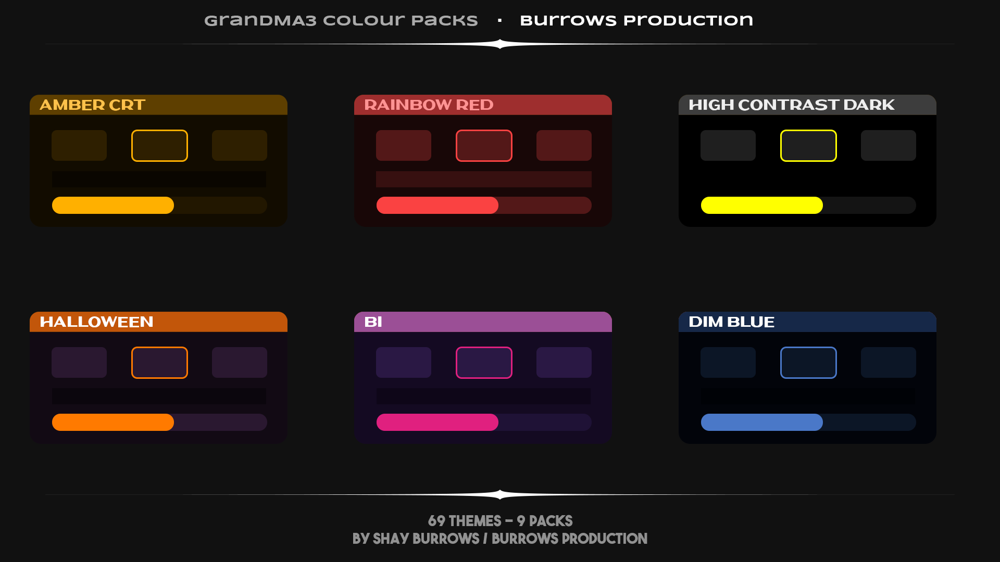

# GrandMA3 Colour Packs ┃ Burrows Production

A collection of 64 colour themes that I made for the GrandMA3 lighting console. Got some moody dark ones for low light situations, some lighter pastel themes and a little inbetween.

Made by **Shay Burrows / [Burrows Production](https://www.instagram.com/burrows.prod/)**

---

## Contents

- [Theme Packs](#theme-packs)
- [Installation](#installation)
- [Switching Themes](#switching-themes)
- [Resetting To Default](#resetting-to-default)

---

## Theme Packs

| Pack | Themes | Style | Preview |
|---|---|---|---|
| **Palette** | 16 | Most of the themes you'll find in an IDE (fully accented) | [View](previews/Palette_Pack_Preview.png) |
| **Rainbow** | 7 | Seven colours of the rainbow | [View](previews/Rainbow_Pack_Preview.png) |
| **Pastel** | 7 | Seven colours of the rainbow, but pastel! **Could be hard to read if colourblind** | [View](previews/Pastel_Rainbow_Preview.png) |
| **Combo** | 10 | Two-colour pairings | [View](previews/Combo_Preview.png) |
| **Pride** | 9 | Pride flag themes | [View](previews/Pride_Preview.png) |
| **Season** | 8 | Seasonal and holiday themes | [View](previews/Season_Preview.png) |
| **LowLight** | 4 | Best for low light environments | [View](previews/LowLight_Preview.png) |
| **Access** | 4 | High-contrast and colour-blind-safe | [View](previews/Access_Preview.png) |
| **Burrows** | 4 | My personal themes :)) | [View](previews/Burrows_Preview.png) |

---

## Installation

### 1. Download

Grab whichever colour pack you want or the combined master pack from the Releases page
